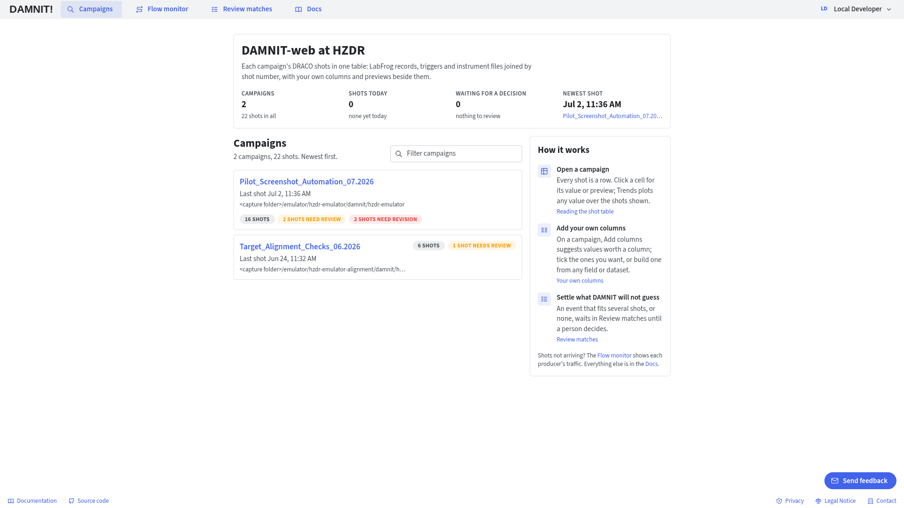
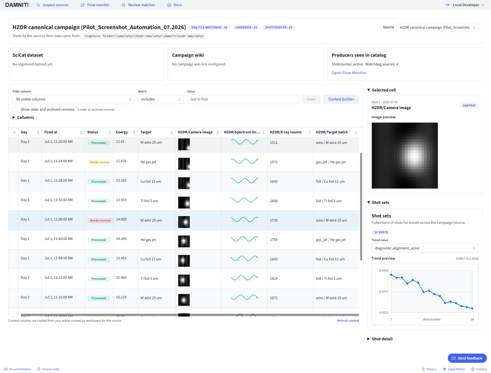
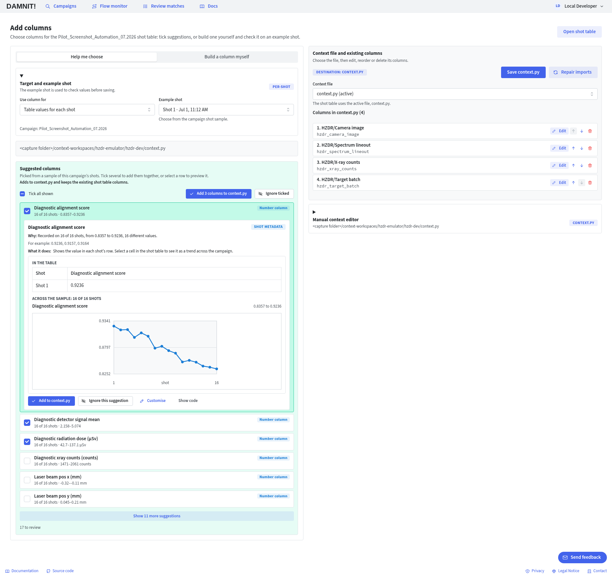
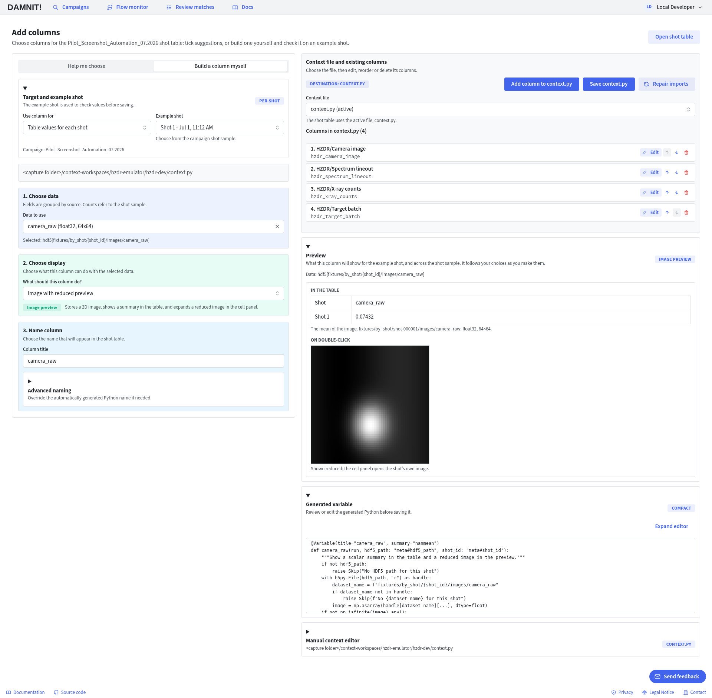
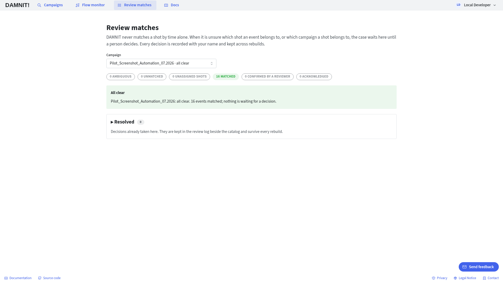
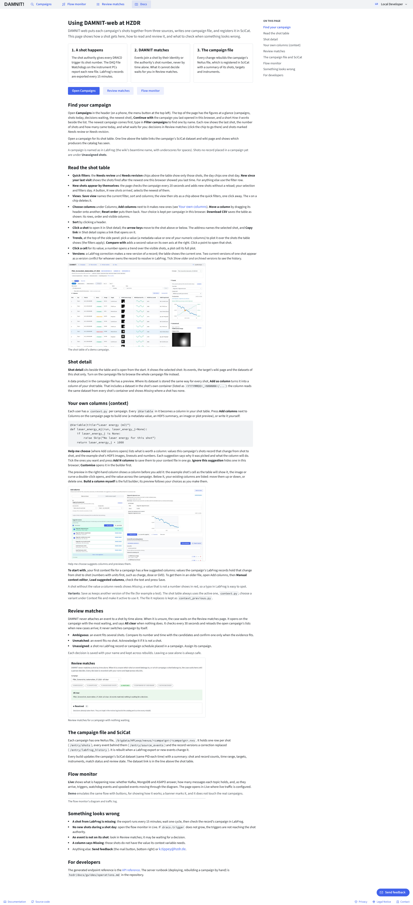
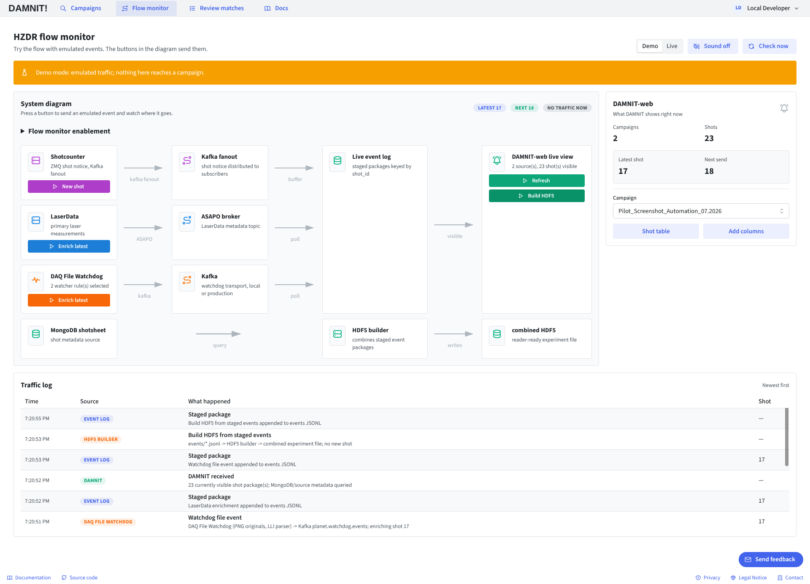

# Screenshots

All seven images are generated from a disposable local fixture stack at a
1920×1080 viewport:

Install frontend dependencies first with `pnpm --dir frontend install --frozen-lockfile`
using Node 24 or newer and the pinned pnpm version. The capture keeps a compatible
Node already on PATH; otherwise it uses the newest installed nvm release matching
the major version in `.nvmrc` (under `NVM_DIR` or `~/.nvm`). This also works from
PowerShell without loading nvm in a profile. It does not install Node or change
your shell configuration.

```powershell
uv run playwright install chromium  # one-time
uv run python hzdr/scripts/capture-screenshots.py
```

The command creates the fixture campaigns, runs the real package emulator,
FastAPI service, and Vite frontend on ephemeral localhost ports, drives every
page below, writes `screenshots/capture-receipt.json`, and stops the processes.
It requires no broker, MongoDB, credentials, or production service.
To use a Chromium that is already installed instead of Playwright's download,
set `HZDR_CHROMIUM_EXECUTABLE` to its binary.
Server output and browser errors are printed to the terminal for troubleshooting.

## What the fixture stack contains

The capture script authors the whole campaign itself, so the pages show a run
rather than a single shot:

- **Two emulated sources.** `Pilot_Screenshot_Automation_07.2026` fires 16 shots
  across two days; `Target_Alignment_Checks_06.2026` adds a shorter 6-shot day.
  Both are normal `hzdr-event-v1` packages fed through
  `api/scripts/hzdr-package-emulator.py`.
- **Five events per shot** from the three Kafka-pilot producers — a Shotcounter
  notice, a LaserData energy reading, a LaserData waveform, and two DAQ File
  Watchdog events from two different watcher computers. That is what fills the
  producer-status view and the context-builder's dataset picker.
- **A seeded `context.py` workspace** whose four variables cover the cell kinds
  DAMNIT-web renders: a camera-frame thumbnail, a per-shot lineout sparkline, a
  numeric column with its campaign trend, and a plain label.
- **A curated LabFrog snapshot** per campaign, in the `shot_summary` shape
  labfrog-sqlite-tools exports, so Review matches has campaign ids to suggest.

Everything lives in a temporary directory and is deleted when the capture ends.
The values are synthetic: they are shaped like a DRACO run, but no shot in them
was ever fired.

## Home — campaigns

The landing page (`/home`, the **Campaigns** tab): every campaign the HZDR
provider sees, newest first, with a filter box. Each row has its last shot
time, shot count, "+N today", the decisions waiting in Review matches and
the shots needing review or revision; the DAMNIT folder is small print.



## Shot table

A campaign page (`/source/{source_key}`): DAMNIT's per-shot table with
status badges, campaign/context columns and inline image and trend previews.
Above it, one line of status chips (SciCat, wiki, producers, Flow monitor),
quick filters for review status and day, and **Add columns** beside Columns.
The capture clicks a camera-image cell of shot 7, so the side panel shows the
full preview, then Shot detail (open by default: facts, the review control,
events, data products and only that shot's datasets as a tree), then Shot
sets with a trend.



## Context builder: Help me choose

`/source/{source_key}/context-builder` as it opens: the campaign's suggested
columns as tickable rows (how many shots record each and the range it spans).
The capture ticks three, so **Add 3 columns** is live. The selected row's
detail sits in the right column: why it was picked, example values, what the
column will do, its preview (the example shot's cell and the campaign trend)
and **Add this column**, **Ignore this suggestion**, **Customise** and **Show
code**; below it, the file's existing columns with Edit, Move and Delete. The
first six rows show; the rest are behind **Show more**, which in this capture
holds the example shot's HDF5 image, lineout and scalar suggestions.



## Context builder: Build a column myself

`/source/{source_key}/context-builder`, the other mode: building one context column from a
per-shot HDF5 dataset — pick the data and what the column should do, and the
preview follows: the example shot's cell (the image's mean), the image a
double-click opens, and the Python that will be appended to `context.py`.



## Review matches

`/review-matches` (the old `/link-shot-records` path redirects there): per
campaign, the cases the builder will not guess — ambiguous events with their
candidate shots to confirm (the closest in time highlighted), unmatched
events to acknowledge, and unassigned shots to assign to a campaign — plus
who resolved what, and when. The picker shows what waits in each campaign
and the page opens on the busiest. The capture campaign has nothing waiting,
so it shows the one "All clear" banner and the folded Resolved list.



## In-app docs

`/docs`: how a shot gets here and how to read and review it, with a
contents list beside the text and a screenshot per section; each section is
linkable (`/docs#review-matches`).



## Flow monitor

`/flow-monitor`: the live system diagram from producers (Shotcounter,
LaserData, DAQ File Watchdog, MongoDB shotsheet) through Kafka/ASAPO into
the staged event log, the HDF5 builder, and the DAMNIT-web live view.
Demo mode (marked by a banner) emulates producer events locally; Live mode,
the default where a spool consumer is enabled, reads real broker/spool
activity. The capture runs one shot through the demo buttons, which is what
fills the full-width traffic log — and why this page is photographed last,
after every page that shows the untouched campaign.


